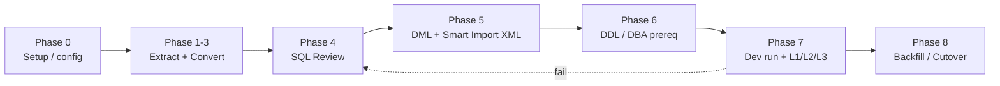
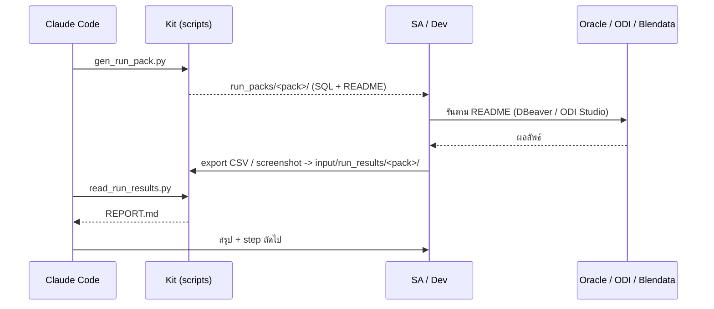

# 01 — Methodology: AI-Assisted Blendata → ODI Migration

Project: **SS_ESIM_L2D** · Workflow: `ss_esim_landing_to_discovery` · Updated: 2026-10-28 · SA: 41642975+iamboy120123@users.noreply.github.com

## 1. หลักการ

- **As-Is migration (ELT pushdown)** — แปลง Spark SQL เป็น Oracle SQL ทีละ task ให้ semantics เท่าเดิม ไม่ redesign business logic
- **Generator-first** — ของที่ส่งเข้า ODI (Smart Import XML) สร้างจาก script เสมอ ไม่แก้ XML ด้วยมือ; แก้ที่ converted SQL / config แล้ว regenerate
- **Offline gate ก่อนแตะระบบจริง** — `validate_odi_xml.py` ต้องผ่าน 0 error ก่อนสร้าง Run Pack
- **Human-decide สำหรับ scope / semantics / cutover** — agent ทำงานกลไก และเขียนคำถามให้ SA ตัดสินใจ

## 2. Phase

| Phase | Input | Output | Gate |
|---|---|---|---|
| 0 | ข้อมูล environment | `config/config.json`, `.claude/`, `.design/` | Pre-flight checklist |
| 1-3 | `export_workflow.json` | `output/sql/raw`, `output/sql/converted`, `status/REVIEW_FLAGS.md` | ทุก task มีไฟล์ |
| 4 | flag + SQL | converted SQL ที่แก้แล้ว, `status/PHASE4_REVIEW_LOG.md` | ไม่มี flag ค้าง |
| 5 | converted SQL | `output/dml`, `PROJ_EXPORT.xml` | validator 0 error |
| 6 | manifest | DDL, DBA prereq | DBA รันผ่าน |
| 7 | Run Pack | `run_packs/<pack>/REPORT.md` | S7 assertion ผ่านครบ, L1-L3 ตรง Blendata |
| 8 | backfill pack, runbook | ข้อมูลย้อนหลัง, go-live | sign-off |

## 3. Courier loop (agent เข้า Oracle / ODI / Blendata ตรงไม่ได้)

ดู `diagrams/courier_loop.mmd`

## 4. Human-decide vs Agent-decide

| Human (SA) | Agent (Claude Code) |
|---|---|
| scope, load strategy, error handling | extract / convert / regenerate / validate |
| การเปลี่ยน semantics / business logic | แก้ dialect ที่ไม่เปลี่ยน semantics |
| logical schema / context / project ODI | สร้าง Run Pack และอ่านผล |
| retention, cutover, rollback, go-live | อัปเดตเอกสารสถานะ / design |
