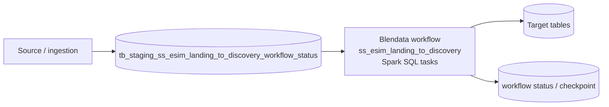
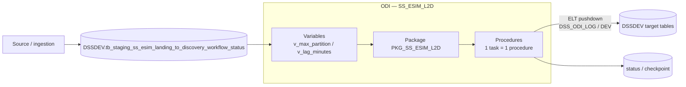

# 02 — Architecture: As-Is vs To-Be

Workflow: `ss_esim_landing_to_discovery` · Updated: 2026-10-28

## 1. As-Is (Blendata)

| รายการ | ค่า | หมายเหตุ |
|---|---|---|
| Scheduler | _(เติม — cron จาก manifest: ดู 04_task_mapping)_ | |
| Engine | Spark SQL (Blendata) | |
| Landing | `tb_staging_ss_esim_landing_to_discovery_workflow_status` | retention: _(Q ใน OPEN_DECISIONS)_ |
| Downstream consumer | _(เติม)_ | |

## 2. To-Be (ODI 14.1.2 / Oracle 19c)

| องค์ประกอบ | ค่า |
|---|---|
| ODI project / package | `SS_ESIM_L2D` / `PKG_SS_ESIM_L2D` |
| Logical schema / context | `DSS_ODI_LOG` / `DEV` |
| Data server login (ต้องเป็น) | `DSSDEV` |
| Scenario / schedule | _(เติม — ODI Agent schedule)_ |

## 3. ความต่างที่ต้องรู้ (As-Is → To-Be)

| เรื่อง | Blendata (Spark) | ODI / Oracle | ผลกระทบ |
|---|---|---|---|
| empty string | `''` ≠ NULL | `''` = NULL | เงื่อนไข `= ''` ต้องแปลงเป็น `IS NULL` |
| overwrite | `INSERT OVERWRITE` | `TRUNCATE` + `INSERT` (execute immediate) | ไม่ atomic — ดู ADR |
| precheck | task SQL | ODI Variable refresh | ดู ADR-002 |
| encoding ของ step | UTF-8 | ISO-8859-1 ใน Smart Export | ห้ามภาษาไทยใน SQL |

## 4. Integration / dependency

_(เติม: ระบบต้นทาง, ปลายทาง, external table, DB link)_
